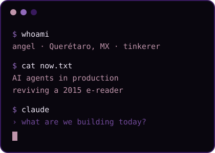
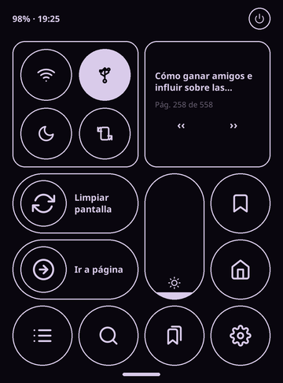

  
  
  
  

<h2 align="center">Hi, I'm Angel</h2>

<table>
<tr>
<td width="58%" valign="top">

The first thing I ever tried to fix was a PlayStation 1. The disc lid was broken and all I had was a folded piece of paper. It didn't always work, and I got frustrated plenty of times, but it taught me something I still believe: you can get surprisingly far with what you have if you understand how it works.

Years later I was flashing ROMs on a Xiaomi Mi A2 every other weekend, until an iPhone 5 showed me the other side: a system so stable and simple you forget it's there. That's the bar I try to build to. I still pick value over hype, and the most open option whenever I can.

Today I build AI products at **Cimiento AI** with **Claude Code**. I decide what gets built, review it, test it on the real system and ship it.

</td>
<td width="42%" align="center" valign="middle">

</td>
</tr>
</table>

## What I like building

<table>
<tr>
<td width="55%" valign="top">

Product. The hardest and most fun part of my job is the user experience: figuring out how a feature can be simple enough for many people to use and actually make their work easier.

At Cimiento AI I designed and built **Auro**, the platform where a business creates its own AI agent. It feeds Auro its website and business info, and in under 40 seconds it has an agent answering its customers on WhatsApp, booking appointments and following up.

Responding to messages is the easy part. The hard part is an agent that qualifies leads, books, follows up and doesn't make things up, every day, with real customers. That's what I work on.

Outside of work I automate my own life and bring old devices back.

</td>
<td width="45%" align="center" valign="top">

</td>
</tr>
</table>

## Projects

<table>
<tr>
<td colspan="2" valign="top">

**Auro** · *Cimiento AI, in production* 
SaaS platform to create AI agents for WhatsApp and Instagram, used by real estate, wellness and retail businesses. I designed and built it end to end: onboarding, the agents (LangGraph), the backend (FastAPI, Celery, PostgreSQL with pgvector) and the dashboard.

**[Tzolk'in](https://www.npmjs.com/package/tzolk)** · *open source on npm, paused* 
AI-first project management: coding agents share the same memory and board as people. CLI and MCP server with persistent context across sessions, multi-tenant organizations and a web dashboard. 15 releases on npm.

</td>
</tr>
<tr>
<td width="64%" valign="top">

**[kobo-glohd](https://github.com/AngelSalinasT/kobo-glohd)** 
A simpler interface for the 2015 Kobo Glo HD on top of KOReader, inspired by Kindle and iOS. Includes a kernel module that fixes the power button, safe battery shutdown and SSH over USB.

**[alcatel-pixi3-10-8080](https://github.com/AngelSalinasT/alcatel-pixi3-10-8080)** 
A bricked tablet brought back to life running LineageOS 14.1: a kernel adapted from a sibling model and a display driver rebuilt by disassembling the stock kernel.

</td>
<td width="36%" align="center" valign="middle">

</td>
</tr>
<tr>
<td valign="top">

**[Lumi](https://github.com/AngelSalinasT/lumi)** 
An AI companion for older adults, so no one has to age alone: it keeps them talking, remembering and socializing. Built with my team at Hackathon Troyano 2026, where I led development and the AI.

**[kontos](https://github.com/AngelSalinasT/kontos)** 
My personal finance assistant, so I stop doing the math by hand. It started as a Telegram bot and now logs expenses automatically.

**[transcribos](https://github.com/AngelSalinasT/transcribos)** 
Local audio transcription on the Mac with Whisper.cpp and Metal.

</td>
<td align="center" valign="middle">

</td>
</tr>
</table>

## A few problems I've cracked

- **A power button that couldn't wake the device.** On the Kobo Glo HD the button stopped working after sleep. A read-only kernel module I wrote to dump GPIO registers showed why: `gpio-keys` asks for both edges, this kernel's mxc GPIO driver emulates that with level triggering, and level interrupts never register while the SoC is asleep. The cover only "worked" because closing it interrupts the infrared touchscreen beams. The fix is a small kernel module that arms the button as a falling-edge wake source before suspend and injects `KEY_POWER` on resume. [Write-up](https://github.com/AngelSalinasT/kobo-glohd/blob/main/docs/05-boton-de-encendido.md)
- **A display driver with no source code.** Alcatel never released the kernel for its Pixi 3 (10) tablet. I recovered the panel's timings, init sequence and GPIOs by disassembling the stock kernel binary, rebuilt the driver, and patched the eMMC 5.1 check that crashed the kernel at boot. [Kernel patches](https://github.com/AngelSalinasT/alcatel-pixi3-10-8080#kernel-changes)
- **Manga pages 13× faster on a 2015 e-reader.** Measured with KOReader's own engine on the device: the CPU wasn't the bottleneck, the image size was. Converting pages to the screen's resolution in grayscale took them from ~1130 ms to ~86 ms. [Numbers](https://github.com/AngelSalinasT/kobo-glohd/blob/main/docs/07-rendimiento.md)
- **The "factory reset" screen.** KOReader never shut the Kobo down at critical battery, so the PMU cut power with storage still mounted, the likely cause of a corrupted filesystem. A plugin now shuts it down cleanly, waking from sleep every 4 hours with an RTC alarm to check. [Details](https://github.com/AngelSalinasT/kobo-glohd/blob/main/docs/06-bateria-y-arranque.md)

> If it hasn't been tested on the real device, it isn't done.

## Where I think this is going

Remember Samantha in *Her*: an operating system you just talk to, and it helps you get your work done. I already work a bit like that. What agents are missing now is their own environment, one where moving around feels natural to them. Claude Code and Codex already work inside your computer, but they're still clumsy because everything they touch was made for humans. MCP helped, but it falls short.

When a model as capable as today's Opus runs locally on something like a MacBook Air, it's going to be wild. That's why I think we should start building tools AI-first. I haven't built it yet. I'd like to.

## Tools I use

  

  
  
  
  

<b>En español</b>

 

**Hola, soy Angel.** Lo primero que intenté arreglar fue un PlayStation 1. La tapa del disco estaba rota y lo único que tenía era un pedazo de papel doblado. No siempre funcionaba y me frustré muchas veces, pero me enseñó algo que sigo creyendo: con lo que tienes llegas sorprendentemente lejos si entiendes cómo funcionan las cosas.

Años después me la pasaba cambiando ROMs a un Xiaomi Mi A2, hasta que un iPhone 5 me enseñó el otro lado: un sistema tan estable y simple que te olvidas de que está ahí. Esa es la vara con la que intento construir. Sigo eligiendo calidad-precio antes que moda, y la opción más libre cuando se puede.

Hoy construyo productos con IA en **Cimiento AI** con **Claude Code**. Yo decido qué se construye, reviso, pruebo en el sistema real y lo pongo en producción.

**Lo que me gusta construir:** producto. Lo más difícil y lo más divertido de mi trabajo es la experiencia de usuario: lograr que una función sea tan simple que la use mucha gente y de verdad le facilite el trabajo. En Cimiento AI diseñé y construí Auro, la plataforma donde un negocio crea su propio agente de IA: le da su sitio web y la información de su negocio, y en menos de 40 segundos tiene un agente que atiende a sus clientes, agenda citas y da seguimiento. Fuera del trabajo automatizo mi vida y revivo aparatos viejos.

**Proyectos:** Auro (la plataforma SaaS de Cimiento AI para crear agentes de IA en menos de 40 segundos; la diseñé y construí de punta a punta), [Tzolk'in](https://www.npmjs.com/package/tzolk) (gestión de proyectos AI-first para agentes de código, CLI y servidor MCP, 15 versiones en npm, en pausa), [kobo-glohd](https://github.com/AngelSalinasT/kobo-glohd), [alcatel-pixi3-10-8080](https://github.com/AngelSalinasT/alcatel-pixi3-10-8080), [Lumi](https://github.com/AngelSalinasT/lumi) (compañía con IA para adultos mayores, hecho con mi equipo en el Hackathon Troyano 2026), [kontos](https://github.com/AngelSalinasT/kontos) y [transcribos](https://github.com/AngelSalinasT/transcribos).

**Problemas que he resuelto:** el botón de encendido de la Kobo que no la despertaba (lo diagnostiqué con un módulo de kernel de solo lectura y lo arreglé con otro), el driver de pantalla de la Alcatel reconstruido desensamblando el kernel original, mangas 13 veces más rápidos en la Kobo midiendo dentro del aparato, y el apagado seguro por batería que evita la pantalla de restaurar de fábrica.

**Hacia dónde creo que va esto:** acuérdate de Samantha en *Her*, un sistema operativo con el que solo hablas y te ayuda a sacar tu trabajo. Yo ya trabajo un poco así. A los agentes les falta su propio entorno, uno donde moverse les resulte natural. Claude Code y Codex ya trabajan dentro de tu computadora, pero todavía son torpes porque todo lo que tocan está hecho para humanos. MCP ayudó, pero se queda corto. Cuando un modelo tan capaz como el Opus de hoy corra localmente en algo como una MacBook Air, va a ser una locura. Por eso creo que hay que empezar a construir herramientas AI-first. Todavía no lo he construido. Me gustaría.

